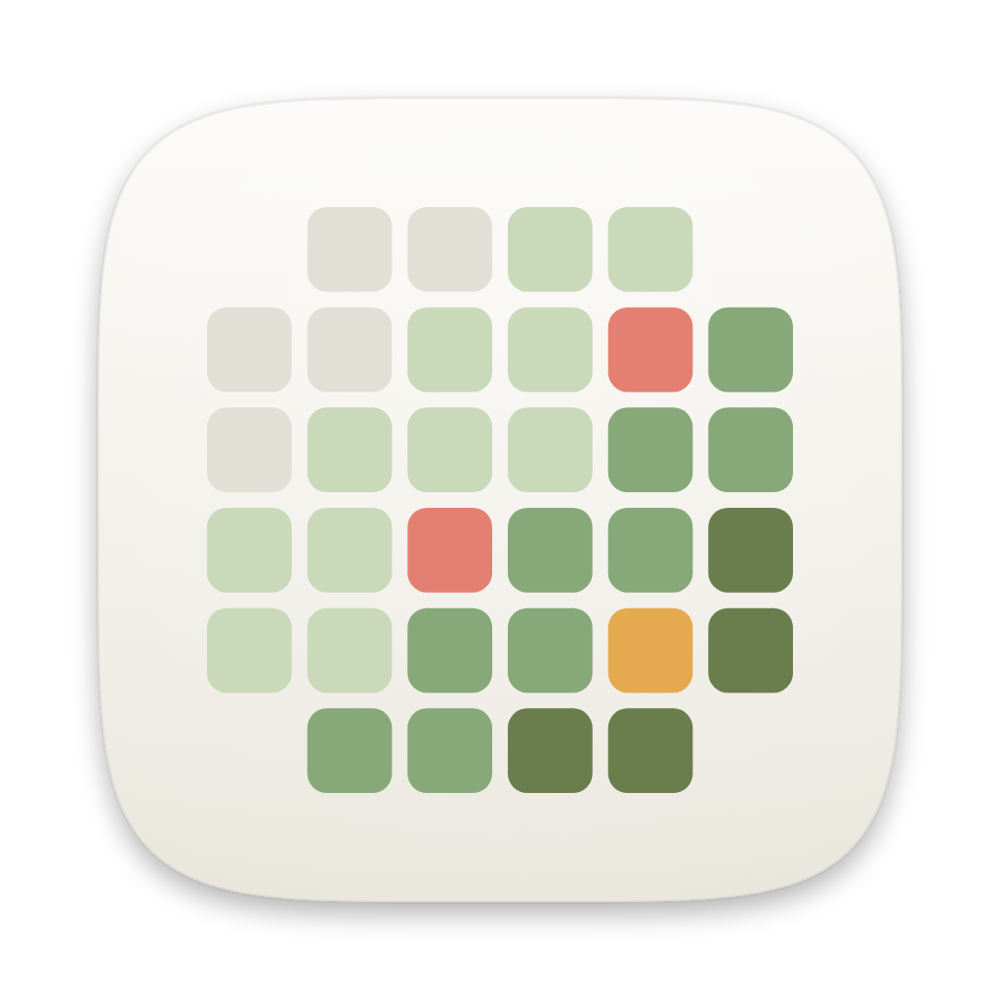
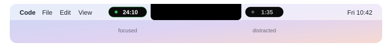
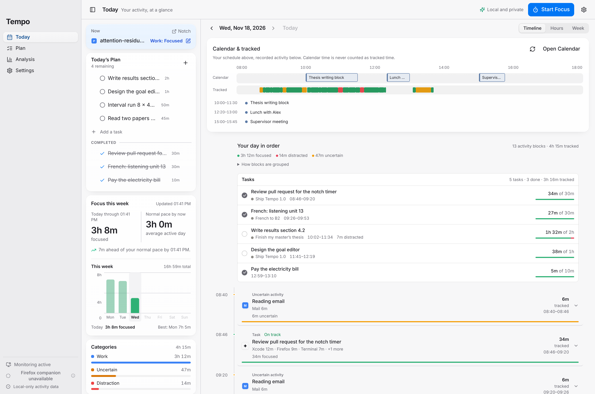
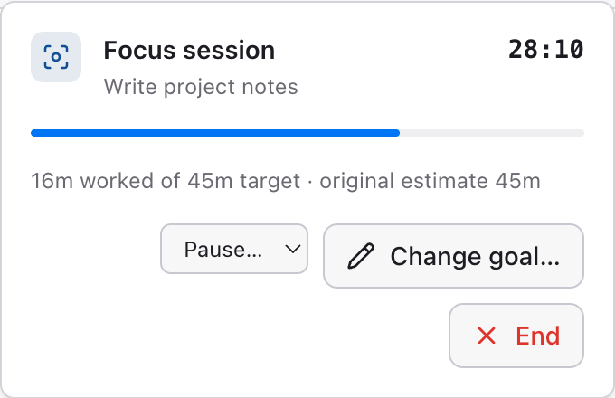
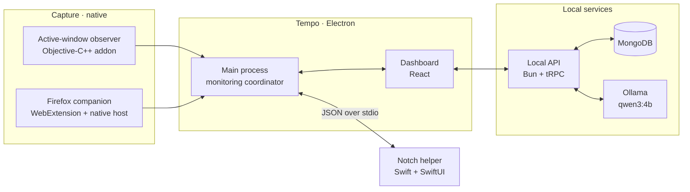

<div align="center">



# Tempo

**Your tasks, your timeline, and a timer in the notch.**

A macOS focus companion that knows what you meant to work on,<br/>
judged by a language model that never leaves your Mac.

[](https://github.com/s-rode/Tempo/actions/workflows/ci.yml)
[](docs/BUILDING.md)
[](docs/BUILDING.md)
[](docs/LOCAL_AI.md)
[](LICENSE)



[Features](#features) · [A closer look](#a-closer-look) · [How it works](#how-it-works) · [Technical notes](#technical-notes) · [Setup](#setup) · [Docs](#documentation)

</div>

<br/>

Most time trackers can tell you that you spent the morning in Firefox. Tempo can tell you how much of it went to the paper you meant to read.

<table>
<tr>
<th width="50%">What a time tracker sees</th>
<th width="50%">What Tempo sees</th>
</tr>
<tr>
<td valign="top">

⚪ &nbsp;Firefox · **1h 44m**

</td>
<td valign="top">

🟢 &nbsp;Read the attention paper · **40m** focused<br/>
🟢 &nbsp;Review API docs · **44m** focused<br/>
🔴 &nbsp;Distracted · **20m**

</td>
</tr>
</table>

You pick a task. A small language model running on your own Mac compares what is on screen with what you meant to do, and nothing leaves the machine. You get a timeline you can read back, a timer that lives in the notch, and a nudge when you drift.



<div align="center">
<table>
<tr>
<td align="center" width="25%"><h3>100%</h3>on-device<br/><sub>no account, no cloud AI, no telemetry</sub></td>
<td align="center" width="25%"><h3>3</h3>languages<br/><sub>TypeScript, Swift, Objective-C++</sub></td>
<td align="center" width="25%"><h3>290+</h3>deterministic tests<br/><sub>plus 466 classifier scenarios</sub></td>
<td align="center" width="25%"><h3>11×</h3>faster analytics<br/><sub>427 ms → 39 ms over 33,600 events</sub></td>
</tr>
</table>
</div>

## Features

<table>
<tr>
<td width="50%" valign="top">

**Task-aware tracking**<br/>
Activity is judged against the task you chose, not against a fixed list of "productive" apps. The same site can be focused work for one task and a distraction for another.

</td>
<td width="50%" valign="top">

**Timers in the notch**<br/>
Focused and distracted time sit beside the camera housing. Hover to see the current activity, change its category, pause, or extend a finished session.

</td>
</tr>
<tr>
<td valign="top">

**A built-in planner**<br/>
Set long-term goals, plan tasks across the week, and work through today's queue one task at a time. Each session can count down the task's estimate, count up, or run as Pomodoro blocks.

</td>
<td valign="top">

**Apple Reminders and Calendar**<br/>
Prefer Reminders? Take your tasks from your Reminders lists instead of the planner. Calendar appointments appear on the same time scale as your activity. Both are read-only, and Tempo can pause tracking during an event.

</td>
</tr>
<tr>
<td valign="top">

**Focus and Pomodoro sessions**<br/>
Start a session from a task and set its length with a slider. When the timer ends, add more time from the notch and keep going.

</td>
<td valign="top">

**A timeline you can read**<br/>
Today shows the day as a timeline of blocks, hour by hour, or as a week. With the planner on, it also lists the time spent on each task against its estimate.

</td>
</tr>
<tr>
<td valign="top">

**Analysis that tells you something**<br/>
See when you focus best, how long your focus lasts, what pulls you away, and how your sessions went compared to their estimates. Tempo turns the clearest patterns into a few suggestions.

</td>
<td valign="top">

**It learns from corrections**<br/>
Fix a wrong classification in the timeline or the notch. Tempo remembers it, and you can set per-app rules for the cases that never change.

</td>
</tr>
<tr>
<td valign="top">

**At home on the Mac**<br/>
A translucent sidebar and glass cards, light and dark mode, menu commands with keyboard shortcuts, and settings laid out in panes like System Settings.

</td>
<td valign="top">

**Private by design**<br/>
No account, no cloud AI, no telemetry. Classification and storage both run on your Mac.

</td>
</tr>
</table>

## A closer look

### The notch

<p align="center">
  
</p>

The notch companion is a separate native Swift app, so the timers stay visible when the main window is closed. It steps aside when another notch app opens over it, and its clocks stop while the Mac is locked or asleep. You can hide the seconds if you find them distracting.

### Planning


Under **Settings → Planning** you choose where tasks come from: Apple Reminders or Tempo's own planner. With the planner on, a Plan page appears in the sidebar with three views.

- **Goals** are the long-term things you are working towards. Tasks can link to a goal.
- **Week** has a column for each day. Drag tasks to reorder them or move them to another day. Typing `Draft chapter 3 #thesis 45m` adds a task with a goal and an estimate. Anything left unfinished moves to today.
- **Queue** shows today's tasks in order. Start working and Tempo shows only the current task. Done starts the next one, Later sends it to the back of the queue.

Details and keyboard shortcuts are in the [planner guide](docs/planner.md).

### Focus sessions

<p align="center">
  
</p>

A session belongs to a task. You can pause it, change the goal while it runs, or extend it from the notch when the timer runs out. Sessions started from the planner queue can be timed in three ways: count down the task's estimate, count up with no fixed length, or work in 30-minute Pomodoro blocks with 5-minute breaks.

### Analysis


The Analysis tab looks at a week or a month. It shows your focus day by day, the hours you focus best in, how long your focus blocks last, which apps and sites pull you away and how long it takes to get back, how timed sessions went against their estimates, and how much you switch between apps. From this it picks up to three suggestions for what to try next.

Everything is computed locally from the same events as the timeline. The screenshots on this page use synthetic data.

## How it works



Everything in this diagram runs on your Mac. The parts talk over loopback, a private Unix socket, or stdio.

1. **Capture.** A native observer reports the frontmost app and window title once it has been stable for 750 ms. In Firefox, a companion extension adds a limited sample of the visible page text.
2. **Check what is already known.** Your per-app rules, earlier corrections and previous decisions for the same activity are checked before any model runs.
3. **Ask the local model.** If none of those apply, one request goes to Ollama with the active task and the evidence. To call something focused, the model has to name the task and point to evidence that was in the request. The server checks this and applies the strictness you chose (Flexible, Balanced or Strict).
4. **When in doubt, don't guess.** A timeout or a malformed answer is recorded as uncertain. Uncertain time never counts as productive and never triggers a distraction alert.
5. **Show it.** The decision drives the notch timers, the timeline, and optional sounds and notifications.

More detail: [architecture](docs/ARCHITECTURE.md) · [classification](docs/CLASSIFICATION.md) · [local AI](docs/LOCAL_AI.md)

## Technical notes

### Keeping a small model honest

A 4B-parameter model is fast enough for a laptop, but it makes up reasons if you let it. Tempo asks for structured output and has the model refer to evidence by short aliases, which the server validates. A malformed reply gets one retry, and the whole pipeline has a ten-second deadline. The model also has to name the subject it sees before giving a verdict. A focused answer is only accepted when that subject really appears in the window title or page text.

### Learning from corrections

A correction applies to the task context it was made in. Broader preferences need several confirmations across sessions, expire without fresh feedback, and are suspended by a single contradicting observation. Tempo never learns from passive use. The rules are in the [classification notes](docs/CLASSIFICATION.md).

### Privacy

Page text and OCR frames are held in memory for one request and then dropped. Prompts and model replies are not stored, and browser caches are keyed by HMAC fingerprints, not by content. App names, window titles and derived summaries are kept in the local database. The notch helper never receives tokens or page text and makes no network requests. The [privacy notes](docs/NETWORK_NOTES.md) list what is stored and what is not.

### Performance

| Change                                                            |      Before |  After |
| ----------------------------------------------------------------- | ----------: | -----: |
| Weekly analytics over 33,600 events                               |      427 ms |  39 ms |
| Notch helper idle CPU (adaptive polling instead of a fixed 10 Hz) | 0.55–0.85 % | ~0.1 % |
| Repeated identical model request (in-memory decision memo)        |       3.4 s |   0 ms |
| Timeline payload for a 931-event day                              |    1,120 KB | 666 KB |

Methods and caveats are in the [performance notes](docs/PERFORMANCE.md).

### Testing

About 290 deterministic tests cover the server and renderer logic. Separate Swift suites cover the notch's layout, timing and lifecycle. The classifier is checked against a live local model with 466 written scenarios: 135 regression cases and 331 harder ones (paraphrases, look-alike keywords, prompt injection, empty windows, several tasks at once). Part of the harder set is held out and never used for tuning. CI runs the deterministic suites on Linux, then builds, tests and verifies the signed app on Apple Silicon. The [validation notes](docs/CLASSIFICATION_VALIDATION.md) explain what each level proves.

## Built with

| Layer          | Technology                                                                         |
| -------------- | ---------------------------------------------------------------------------------- |
| Desktop app    | Electron, React 19, TypeScript, Tailwind CSS, tRPC + React Query                   |
| Local API      | Bun, tRPC, Mongoose, Zod                                                           |
| Storage        | MongoDB (local)                                                                    |
| AI             | Ollama with `qwen3:4b-instruct`, structured JSON output                            |
| macOS native   | Swift, SwiftUI and AppKit (notch helper); Objective-C++ N-API addon                |
| Browser        | Firefox WebExtension with a Swift native-messaging host; Apple Vision OCR fallback |
| Tooling and CI | Bun test, electron-vite, electron-builder, GitHub Actions                          |

```text
electron-app/   desktop app, native addon, notch helper, Firefox companion
server/         local API, classification pipeline, evaluation fixtures
shared/         types shared between app and server
docs/           architecture, classification, privacy, performance, build
```

## Setup

You need an **Apple Silicon Mac running macOS 14 or later**. Tempo is built from source and needs these installed:

| Install        | Requirements                                                               |
| -------------- | -------------------------------------------------------------------------- |
| Build tools    | Xcode Command Line Tools, Node **22.23.2**, Bun **1.4.0**, Python **3.11** |
| Local services | MongoDB Community **8.0**, Ollama with **`qwen3:4b-instruct`**             |

Start MongoDB and Ollama, then run:

```sh
git clone https://github.com/s-rode/Tempo.git
cd Tempo
bun run setup
bun run dev
```

The development app uses its own profile and a test database. To check the source and build an app bundle:

```sh
bun run typecheck
bun run test
bun run build
```

The [build guide](docs/BUILDING.md) covers Python setup, installation, backups, and native checks. Builds are signed locally and are not notarized.

<details>
<summary><strong>Setting up Firefox</strong></summary>

The build creates an unsigned ZIP of the [Firefox companion](electron-app/firefox-extension). Load it through Firefox's `about:debugging` page. You have to reload it after restarting Firefox, because a permanent install in standard Firefox needs a Mozilla-signed XPI.

Chrome and Safari work without an extension through macOS browser automation.

</details>

<details>
<summary><strong>Permissions</strong></summary>

Apple Reminders and Calendar access are optional and read-only. Accessibility improves window-change detection. Screen Recording is only needed for the Firefox OCR fallback.

</details>

<details>
<summary><strong>Trying it with sample data</strong></summary>

The [demo guide](docs/DEMONSTRATION.md) shows how to seed a separate database and profile, so your real activity stays untouched.

</details>

## Documentation

| Guide                                                          | What's inside                                             |
| -------------------------------------------------------------- | --------------------------------------------------------- |
| [Architecture](docs/ARCHITECTURE.md)                           | Processes, boundaries and how activity flows between them |
| [Classification and learning](docs/CLASSIFICATION.md)          | The decision pipeline and the rules for corrections       |
| [Local AI and browser support](docs/LOCAL_AI.md)               | The model, its limits, and what each browser provides     |
| [Privacy and stored data](docs/NETWORK_NOTES.md)               | What is kept, what is not, and what touches the network   |
| [Performance](docs/PERFORMANCE.md)                             | Measurements, methods and caveats                         |
| [Classification evaluation](docs/CLASSIFICATION_VALIDATION.md) | What each level of testing does and does not prove        |
| [Build and install](docs/BUILDING.md)                          | Toolchain, checks, installation and rollback              |
| [Planner](docs/planner.md)                                     | Goals, the week plan, the queue and its shortcuts         |
| [Apple Reminders](docs/apple-reminders.md)                     | Read-only planning from Reminders lists                   |
| [Apple Calendar](docs/apple-calendar.md)                       | Read-only appointments on the timeline                    |

## Credits & license

Tempo is developed by **s-rode** and builds on [Cronus](docs/PROVENANCE.md) by Moritz Wallawitsch and Arne Strickmann. It adds local AI, correction learning, task-based focus sessions, a built-in planner, notch controls, Firefox support, Apple Reminders and Calendar, and reworked timelines and analysis.

Both Tempo and the Cronus foundation are licensed under [MIT](LICENSE). Original copyright notices are preserved in [NOTICE](NOTICE); dependencies and assets are covered in the [third-party notices](docs/THIRD_PARTY_NOTICES.md).
