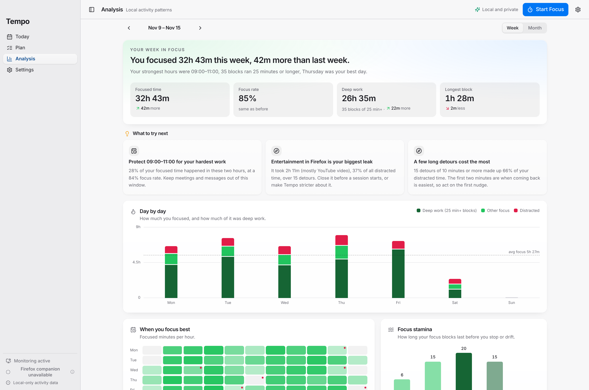

<div align="center">


# Tempo

A focus tracker for macOS.

[](https://github.com/s-rode/Tempo/actions/workflows/ci.yml)
[](docs/BUILDING.md)
[](LICENSE)


[Features](#features) · [How it works](#how-it-works) · [Setup](#setup) · [Docs](#documentation)

</div>

You pick the task you want to work on, and a small language model running on your Mac checks whether what is on screen matches it. Nothing leaves the machine.

It shows the day as a timeline, keeps a focused and a distracted timer next to the MacBook notch, and can nudge you when you drift. It also has a simple planner for goals and tasks, or it can read your tasks from Apple Reminders.


## Features

- **Task-aware tracking.** Activity is judged against the task you chose, not a fixed list of "productive" apps. The same site can be work for one task and a distraction for another.
- **Timers in the notch.** A small native helper shows focused and distracted time beside the notch, even with the main window closed. Hover it to see the current activity, fix its category, pause, or add time to a finished session.
- **Planner.** Long-term goals, a week plan and a queue for today. Tasks can link to a goal and carry an estimate. Sessions can count down the estimate, count up, or run as Pomodoro blocks.
- **Apple Reminders and Calendar.** Use Reminders lists instead of the planner if you prefer. Calendar events show up on the timeline. Both are read-only.
- **Timeline.** Today as blocks, hour by hour, or as a week, with the time spent on each task against its estimate.
- **Analysis.** A week or month view of when you focus best, how long focus lasts, what pulls you away, how sessions went against their estimates, and how much time each goal got against its weekly target.
- **Corrections.** Fix a wrong classification in the timeline or the notch and Tempo remembers it. Per-app rules cover the cases that never change.
- **Private.** No account, no cloud AI, no telemetry. Classification and storage run on your Mac.

### Notch

<p align="center">
  
</p>

### Planner


Turn the planner on under **Settings → Planning**. Quick entry understands goals and estimates, so `Draft chapter 3 #thesis 45m` adds a 45-minute task linked to the thesis goal. Unfinished tasks move to today. See the [planner guide](docs/planner.md) for shortcuts.

### Focus sessions

<p align="center">
  
</p>

### Analysis



Analysis is computed locally from the same events as the timeline and ends with up to three suggestions. The screenshots use sample data.

## How it works

1. A native observer reports the frontmost app and window title. In Firefox, a companion extension adds some of the visible page text.
2. Your per-app rules and earlier corrections are checked first.
3. If they don't decide it, the activity and your task go to a local model through [Ollama](https://ollama.com) (`qwen3:4b-instruct`). A "focused" answer is only accepted if it points to evidence that is actually in the window title or page text.
4. Timeouts and unclear answers are recorded as uncertain. Uncertain time never counts as focused and never triggers an alert.

Page text is only held in memory for the request. App names, window titles and summaries are stored in a local MongoDB database. More in [architecture](docs/ARCHITECTURE.md), [classification](docs/CLASSIFICATION.md) and [privacy](docs/NETWORK_NOTES.md).

The app is Electron with React and TypeScript. The local API runs on Bun with tRPC. The notch helper is Swift and SwiftUI, and window tracking is an Objective-C++ addon.

```text
electron-app/   desktop app, native addon, notch helper, Firefox companion
server/         local API and classification
shared/         types shared between app and server
docs/           longer documentation
```

## Setup

Tempo needs an Apple Silicon Mac with macOS 14 or later and is built from source. Install:

- Xcode Command Line Tools, Node 22.23.2, Bun 1.4.0 and Python 3.11
- MongoDB Community 8.0
- Ollama with `qwen3:4b-instruct`

Start MongoDB and Ollama, then:

```sh
git clone https://github.com/s-rode/Tempo.git
cd Tempo
bun run setup
bun run dev
```

The dev app uses its own profile and a test database. `bun run typecheck`, `bun run test` and `bun run build` check the code and build the app. Builds are signed locally and not notarized. The [build guide](docs/BUILDING.md) covers installing, backups and rollback, and the [demo guide](docs/DEMONSTRATION.md) explains how to try Tempo with sample data.

**Firefox:** the build makes an unsigned ZIP of the [companion extension](electron-app/firefox-extension). Load it from `about:debugging`; it has to be reloaded after Firefox restarts. Chrome and Safari work without an extension.

**Permissions:** Reminders and Calendar access are optional and read-only. Accessibility improves window tracking. Screen Recording is only used for the Firefox OCR fallback.

## Documentation

- [Architecture](docs/ARCHITECTURE.md)
- [Classification and learning](docs/CLASSIFICATION.md) and [how it is evaluated](docs/CLASSIFICATION_VALIDATION.md)
- [Local AI and browser support](docs/LOCAL_AI.md)
- [Privacy and stored data](docs/NETWORK_NOTES.md)
- [Performance](docs/PERFORMANCE.md)
- [Build and install](docs/BUILDING.md)
- [Planner](docs/planner.md), [Apple Reminders](docs/apple-reminders.md), [Apple Calendar](docs/apple-calendar.md)

## Credits and license

Tempo is built by s-rode on top of [Cronus](docs/PROVENANCE.md) by Moritz Wallawitsch and Arne Strickmann. Both are [MIT](LICENSE) licensed. Original notices are in [NOTICE](NOTICE), and dependencies are listed in the [third-party notices](docs/THIRD_PARTY_NOTICES.md).
