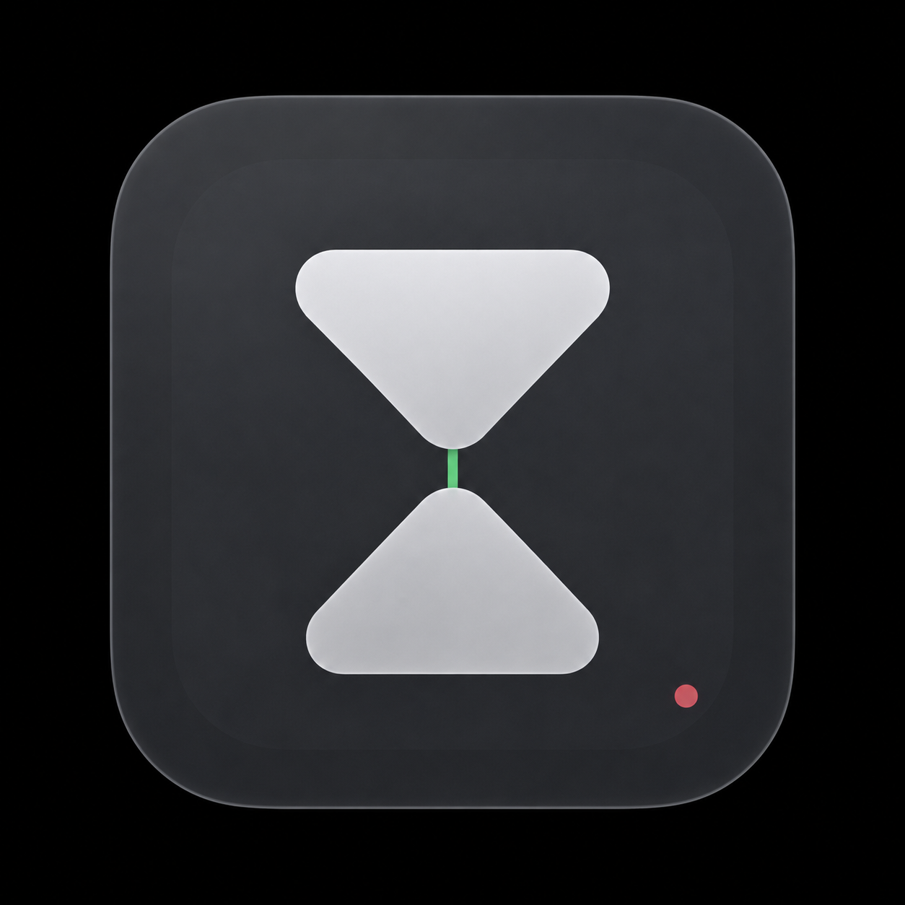

# Tempo Local



Tempo is a local macOS focus companion built from Cronus, with local AI classification, persisted focus sessions, task planning, Apple Reminders, and native notch timers.

**Prepared locally for publication review.** The source/history audit and fresh-clone build pass; see [verification status](docs/publication/STATUS.md) for completed installed checks and explicit manual acceptance limits. No public repository or release has been created.

Cronus supplies the Electron/macOS monitoring and activity-dashboard foundation. Samuel R’s Tempo development adds the local Ollama pipeline and scoped learning, task-linked focus/Pomodoro sessions, native notch controls, Firefox companion, Reminders planning, and later analytics and stability improvements. The provenance and history records distinguish those contributions from imported source.

## Features

- Active-application and browser monitoring, grounded goal-aware classification through local Ollama, and explicit correction learning.
- Custom Focus, Pomodoro, task estimates, manual pauses, lock/sleep suspension, and restart recovery.
- Native notch timers and controls, activity history, day/week reporting, analytics, sounds, and local notifications.
- Manual task planning and an optional, read-only Apple Reminders connection.
- Firefox navigation/context companion with ephemeral visible-text/OCR fallback; existing Chrome/Safari browser capture.

## Build

Apple Silicon; macOS 14+; Xcode Command Line Tools; Python 3; Node **22.23.2**; Bun **1.4.0**. Runtime requirements are local MongoDB Community 8.0 and Ollama with `qwen3:4b-instruct`. Models and services are not bundled.

```sh
bun run setup
bun run typecheck
bun run test
bun run test:native
bun run build
```

For development, `bun run dev` uses a separate profile, port 3301, and `tempo_test_publication` database. The development profile does not register the normal Firefox native host. Normal builds use port 3001 and the existing `tempo_local` database.

Install with `bun run install:local` only after the backup and validation procedure in [BUILDING](docs/BUILDING.md). Source builds use local ad-hoc signing, not Developer ID or notarization. No cloud credentials are required.

## Permissions and privacy

Accessibility is optional. Screen Recording is optional for Firefox OCR fallback. Apple Events access is used by supported browser capture. Reminders access is requested only after Connect; Tempo never edits or completes Apple reminders.

The app's API, database, and model inference run locally. Page text and OCR images are transient; derived activity metadata, goals, corrections, and task context are persisted locally. See [privacy and network details](docs/NETWORK_NOTES.md).

The Firefox extension source and unsigned development package are included. Temporary development loading must be repeated after browser restarts as required by Firefox. Permanent installation in standard Firefox requires a separately Mozilla-signed XPI; no signing submission is part of this source repository.

For a portfolio demonstration using authored sample data, follow [the isolated demo guide](docs/DEMONSTRATION.md).

## Provenance

The foundation is the verified MIT Cronus snapshot at `222adf835a3a210ca5375a3876e7ed1fed31bb9e`. Preserve its copyright and license notice. Tempo's added features and publication-port work are described in [PROVENANCE](docs/PROVENANCE.md), with the source inventory and reconstructed-history mapping under `docs/publication/`.

See [development history and ongoing review](docs/DEVELOPMENT_HISTORY.md) for the reconstruction and normal development workflow.

This repository is a derivative personal project and is not an upstream Cronus release.
