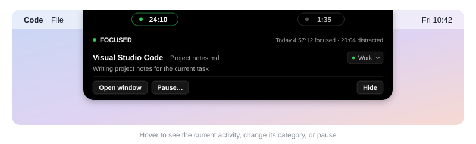
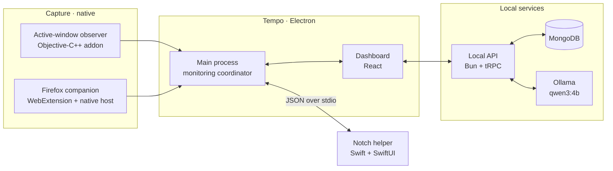

<div align="center">


# Tempo

**Your tasks, your timeline, and a timer in the notch.**


[](https://github.com/s-rode/Tempo/actions/workflows/ci.yml)
[](docs/BUILDING.md)
[](docs/BUILDING.md)
[](docs/LOCAL_AI.md)
[](LICENSE)

[Features](#what-it-does) · [How it works](#how-it-works) · [Engineering](#engineering-notes) · [Setup](#setup) · [Docs](#documentation)

</div>

Most time trackers can tell you that you spent the morning in Firefox. Tempo can tell you how much of it went to the paper you meant to read.

<table>
<tr>
<th width="50%">What a time tracker sees</th>
<th width="50%">What Tempo sees</th>
</tr>
<tr>
<td valign="top">

🌐 &nbsp;Firefox · **1h 44m**

</td>
<td valign="top">

🟢 &nbsp;Read the attention paper · **40m** focused<br/>
🟢 &nbsp;Review API docs · **44m** focused<br/>
🔴 &nbsp;Distracted · **20m**

</td>
</tr>
</table>

You pick a task. A small language model running on your own Mac compares what is on screen with what you meant to do, and nothing leaves the machine. You get a timeline you can read back, a timer that lives in the notch, and a nudge when you drift.


## What it does

|                                  |                                                                                                                                                                             |
| -------------------------------- | --------------------------------------------------------------------------------------------------------------------------------------------------------------------------- |
| **Task-aware tracking**          | Activity is judged against the task you chose, not against a fixed list of "productive" apps. The same site can be focused work for one task and a distraction for another. |
| **Timers in the notch**          | Focused and distracted time sit beside the camera housing. Hover to see the current activity, change its category, pause, or extend a finished session.                     |
| **Focus and Pomodoro sessions**  | Start a session from a task with a time estimate. When the timer ends, add up to two more hours from the notch and keep going.                                              |
| **A timeline you can read**      | The day is grouped into blocks around goals, activity changes and gaps, next to your calendar. Expand a block to see what was inside it.                                    |
| **It learns from corrections**   | Fix a wrong classification in the timeline or the notch. Tempo remembers it, and you can set per-app rules for the cases that never change.                                 |
| **Apple Reminders and Calendar** | Plan from your Reminders lists and see appointments on the same time scale. Both are read-only, and Tempo can pause tracking during an event.                               |
| **Weekly and monthly analytics** | Focus ratio, productive hours, app switches and your focus rhythm across the day.                                                                                           |
| **Private by design**            | No account, no cloud AI, no telemetry. Classification and storage both run on your Mac.                                                                                     |

### The notch

<p align="center">
  
</p>

The notch companion is a separate native Swift app, so the timers stay visible and responsive even when the main window is closed. It steps aside when another notch app opens over it, and it freezes its clocks when the Mac is locked or asleep.

### Sessions and analytics

<p align="center">
  
</p>


## How it works



Everything in this diagram runs on your Mac and talks over loopback, a private Unix socket, or stdio.

1. **Capture.** A native observer reports the frontmost app and window title once it has been stable for 750 ms. In Firefox, a companion extension adds a bounded sample of the visible page text.
2. **Decide cheaply first.** Your per-app rules, earlier corrections and previous decisions for the same activity are checked before any model runs.
3. **Ask the local model.** Otherwise one request goes to Ollama with the active task and the evidence. To call something focused, the model has to name the task and cite evidence that was actually in the request. The server verifies those citations and applies your chosen strictness (Flexible, Balanced or Strict).
4. **Fail safe.** A timeout or a malformed answer is recorded as uncertain. It never earns productive time and never triggers a distraction alert.
5. **Show it.** The decision drives the notch timers, the timeline, and optional sounds and notifications.

More detail: [architecture](docs/ARCHITECTURE.md) · [classification](docs/CLASSIFICATION.md) · [local AI](docs/LOCAL_AI.md)

## Engineering notes

A few parts of the project that were interesting to build.

**Grounded decisions from a small model.** A 4B-parameter model is fast enough to run on a laptop but will happily invent reasons. Tempo constrains it with structured output, short evidence aliases instead of free text, server-side validation of every cited alias, one compact retry for malformed replies, and a hard ten-second deadline for the whole pipeline.

**Learning that cannot run away.** Corrections are explicit and scoped. A correction applies to the task context it was made in, broader preferences need several independent confirmations across sessions, they expire without fresh feedback, and one negative observation suspends them. Passive use never teaches anything. The rules are in the [classification notes](docs/CLASSIFICATION.md).

**Privacy as an architectural constraint.** Page text and OCR frames exist only in memory for the duration of one request. Prompts and model replies are not stored, and browser caches are keyed by HMAC fingerprints, not by content. App names, window titles and derived summaries are kept in the local database, and the docs say so plainly. The notch helper never receives tokens or page text and makes no network requests. What is and is not stored is spelled out in the [privacy notes](docs/NETWORK_NOTES.md).

**Three languages, clear boundaries.** The dashboard is React and TypeScript, window capture is an Objective-C++ N-API addon, and the notch is a standalone Swift app that speaks a versioned JSON protocol over stdio. Each piece can crash, restart or be replaced without taking the others down.

**Measured performance work.** An always-on app has to stay out of the way, so changes are profiled before and after:

| Change                                                            |      Before |  After |
| ----------------------------------------------------------------- | ----------: | -----: |
| Weekly analytics over 33,600 events                               |      427 ms |  39 ms |
| Notch helper idle CPU (adaptive polling instead of a fixed 10 Hz) | 0.55–0.85 % | ~0.1 % |
| Repeated identical model request (in-memory decision memo)        |       3.4 s |   0 ms |
| Timeline payload for a 931-event day                              |    1,120 KB | 666 KB |

Methods and caveats are in the [performance notes](docs/PERFORMANCE.md).

**Tested at several levels.** About 290 deterministic tests cover the server and renderer logic, and separate Swift suites cover the notch's layout, timing and lifecycle policies. A fixed set of 135 authored scenarios (including prompt-injection and held-out transfer cases) checks the classifier against a live local model. CI runs the deterministic suites on Linux and builds, tests and verifies the signed app on Apple Silicon. See [validation](docs/CLASSIFICATION_VALIDATION.md) for what each level does and does not prove.

## Built with

| Layer          | Technology                                                                         |
| -------------- | ---------------------------------------------------------------------------------- |
| Desktop app    | Electron, React 19, TypeScript, Tailwind CSS, tRPC + React Query                   |
| Local API      | Bun, tRPC, Mongoose, Zod                                                           |
| Storage        | MongoDB (local)                                                                    |
| AI             | Ollama with `qwen3:4b-instruct`, structured JSON output                            |
| macOS native   | Swift, SwiftUI and AppKit (notch helper); Objective-C++ N-API addon                |
| Browser        | Firefox WebExtension with a Swift native-messaging host; Apple Vision OCR fallback |
| Tooling and CI | Bun test, electron-vite, electron-builder, GitHub Actions                          |

```text
electron-app/   desktop app, native addon, notch helper, Firefox companion
server/         local API, classification pipeline, evaluation fixtures
shared/         types shared between app and server
docs/           architecture, classification, privacy, performance, build
```

## Setup

You'll need an **Apple Silicon Mac running macOS 14 or later**. Tempo builds from source and needs the following installed:

| Install        | Requirements                                                               |
| -------------- | -------------------------------------------------------------------------- |
| Build tools    | Xcode Command Line Tools, Node **22.23.2**, Bun **1.4.0**, Python **3.11** |
| Local services | MongoDB Community **8.0**, Ollama with **`qwen3:4b-instruct`**             |

Start MongoDB and Ollama, then run:

```sh
git clone https://github.com/s-rode/Tempo.git
cd Tempo
bun run setup
bun run dev
```

The development app uses a separate profile and test database. To check the source and build an app bundle:

```sh
bun run typecheck
bun run test
bun run build
```

The [build guide](docs/BUILDING.md) covers Python setup, installation, backups, and native checks. Builds are signed locally; they aren't notarized.

<details>
<summary><strong>Setting up Firefox</strong></summary>

The build creates an unsigned ZIP of the [Firefox companion](electron-app/firefox-extension). Load it through Firefox's `about:debugging` page for development. You'll need to reload it after restarting Firefox. Permanent installation in standard Firefox requires a Mozilla-signed XPI.

Chrome and Safari work without an extension through macOS browser automation.

</details>

<details>
<summary><strong>Permissions</strong></summary>

Apple Reminders and Calendar access are optional and read-only. Accessibility improves window-change detection. Screen Recording is only needed for the Firefox OCR fallback.

</details>

<details>
<summary><strong>Trying it with sample data</strong></summary>

The screenshots above use synthetic data. The [demo guide](docs/DEMONSTRATION.md) shows how to seed an isolated database and profile without touching real activity.

</details>

## Documentation

- [Architecture](docs/ARCHITECTURE.md)
- [Classification and learning](docs/CLASSIFICATION.md)
- [Local AI and browser support](docs/LOCAL_AI.md)
- [Privacy and stored data](docs/NETWORK_NOTES.md)
- [Performance](docs/PERFORMANCE.md)
- [Classification evaluation](docs/CLASSIFICATION_VALIDATION.md)
- [Build and install](docs/BUILDING.md)
- [Apple Reminders](docs/apple-reminders.md) · [Apple Calendar](docs/apple-calendar.md)

## Credits & license

Tempo is developed by **s-rode** and builds on [Cronus](docs/PROVENANCE.md) by Moritz Wallawitsch and Arne Strickmann. It adds local AI, correction learning, task-based focus sessions, notch controls, Firefox support, Apple Reminders and Calendar, and updated timelines and analytics.

Both Tempo and the Cronus foundation are licensed under [MIT](LICENSE). Original copyright notices are preserved in [NOTICE](NOTICE); dependencies and assets are covered in the [third-party notices](docs/THIRD_PARTY_NOTICES.md).
