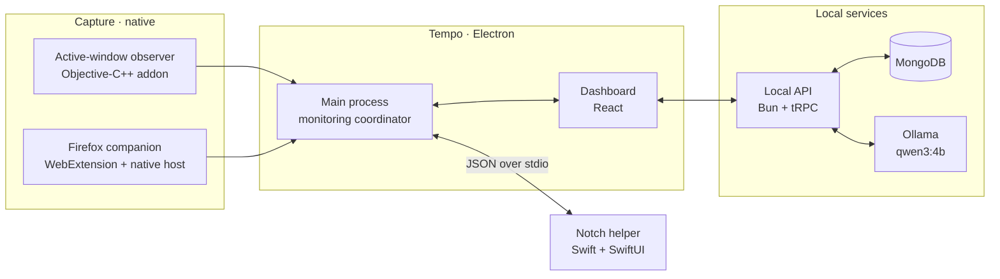

<div align="center">


# Tempo

A macOS focus tracker that checks your activity against the task you chose, using a local language model.

[](https://github.com/s-rode/Tempo/actions/workflows/ci.yml)
[](docs/BUILDING.md)
[](docs/BUILDING.md)
[](docs/LOCAL_AI.md)
[](LICENSE)


[Features](#features) · [A closer look](#a-closer-look) · [How it works](#how-it-works) · [Technical notes](#technical-notes) · [Setup](#setup) · [Docs](#documentation)

</div>

Tempo is a focus tracker for macOS. You pick the task you want to work on, and a small language model running locally on your Mac checks whether what is on screen matches it. Nothing leaves the machine.

It shows the day as a timeline, keeps a focused and a distracted timer next to the MacBook notch, and can nudge you when you drift. It also has a simple planner for goals and tasks, or it can read your tasks from Apple Reminders.


## Features

- **Task-aware tracking.** Activity is judged against the task you chose, not a fixed list of "productive" apps. The same site can be work for one task and a distraction for another.
- **Timers in the notch.** A small native helper shows focused and distracted time beside the notch, even with the main window closed. Hover it to see the current activity, fix its category, pause, or add time to a finished session.
- **Planner.** Long-term goals, a week plan and a queue for today. Tasks can link to a goal and carry an estimate. Sessions can count down the estimate, count up, or run as Pomodoro blocks.
- **Apple Reminders and Calendar.** Use Reminders lists instead of the planner if you prefer. Calendar events show up on the timeline. Both are read-only.
- **Timeline.** Today as blocks, hour by hour, or as a week, with the time spent on each task against its estimate.
- **Analysis.** A week or month view of when you focus best, how long focus lasts, what pulls you away, how sessions went against their estimates, and how much time each goal got against its weekly target.
- **Corrections.** Fix a wrong classification in the timeline or the notch and Tempo remembers it. Per-app rules cover the cases that never change.
- **Private.** No account, no cloud AI, no telemetry. Classification and storage run on your Mac.

### Notch

<p align="center">
  
</p>

### Planner


Turn the planner on under **Settings → Planning**. Quick entry understands goals and estimates, so `Draft chapter 3 #thesis 45m` adds a 45-minute task linked to the thesis goal. Unfinished tasks move to today. See the [planner guide](docs/planner.md) for shortcuts.

### Focus sessions

<p align="center">
  
</p>

### Analysis


Analysis is computed locally from the same events as the timeline and ends with up to three suggestions. The screenshots use sample data.

## How it works



Everything in this diagram runs on your Mac. The parts talk over loopback, a private Unix socket, or stdio.

1. **Capture.** A native observer reports the frontmost app and window title once it has been stable for 750 ms. In Firefox, a companion extension adds a limited sample of the visible page text.
2. **Check what is already known.** Your per-app rules, earlier corrections and previous decisions for the same activity are checked before any model runs.
3. **Ask the local model.** If none of those apply, one request goes to Ollama with the active task and the evidence. To call something focused, the model has to name the task and point to evidence that was in the request. The server checks this and applies the strictness you chose (Flexible, Balanced or Strict).
4. **When in doubt, don't guess.** A timeout or a malformed answer is recorded as uncertain. Uncertain time never counts as productive and never triggers a distraction alert.
5. **Show it.** The decision drives the notch timers, the timeline, and optional sounds and notifications.

More detail: [architecture](docs/ARCHITECTURE.md) · [classification](docs/CLASSIFICATION.md) · [local AI](docs/LOCAL_AI.md)

## Technical notes

### Keeping a small model honest

A 4B-parameter model is fast enough for a laptop, but it makes up reasons if you let it. Tempo asks for structured output and has the model refer to evidence by short aliases, which the server validates. A malformed reply gets one retry, and the whole pipeline has a ten-second deadline. The model also has to name the subject it sees before giving a verdict. A focused answer is only accepted when that subject really appears in the window title or page text.

### Learning from corrections

A correction applies to the task context it was made in. Broader preferences need several confirmations across sessions, expire without fresh feedback, and are suspended by a single contradicting observation. Tempo never learns from passive use. The rules are in the [classification notes](docs/CLASSIFICATION.md).

### Privacy

Page text and OCR frames are held in memory for one request and then dropped. Prompts and model replies are not stored, and browser caches are keyed by HMAC fingerprints, not by content. App names, window titles and derived summaries are kept in the local database. The notch helper never receives tokens or page text and makes no network requests. The [privacy notes](docs/NETWORK_NOTES.md) list what is stored and what is not.

### Performance

| Change                                                            |      Before |  After |
| ----------------------------------------------------------------- | ----------: | -----: |
| Weekly analytics over 33,600 events                               |      427 ms |  39 ms |
| Notch helper idle CPU (adaptive polling instead of a fixed 10 Hz) | 0.55–0.85 % | ~0.1 % |
| Repeated identical model request (in-memory decision memo)        |       3.4 s |   0 ms |
| Timeline payload for a 931-event day                              |    1,120 KB | 666 KB |

Methods and caveats are in the [performance notes](docs/PERFORMANCE.md).

### Testing

About 290 deterministic tests cover the server and renderer logic. Separate Swift suites cover the notch's layout, timing and lifecycle. The classifier is checked against a live local model with 466 written scenarios: 135 regression cases and 331 harder ones (paraphrases, look-alike keywords, prompt injection, empty windows, several tasks at once). Part of the harder set is held out and never used for tuning. CI runs the deterministic suites on Linux, then builds, tests and verifies the signed app on Apple Silicon. The [validation notes](docs/CLASSIFICATION_VALIDATION.md) explain what each level proves.

## Built with

| Layer          | Technology                                                                         |
| -------------- | ---------------------------------------------------------------------------------- |
| Desktop app    | Electron, React 19, TypeScript, Tailwind CSS, tRPC + React Query                   |
| Local API      | Bun, tRPC, Mongoose, Zod                                                           |
| Storage        | MongoDB (local)                                                                    |
| AI             | Ollama with `qwen3:4b-instruct`, structured JSON output                            |
| macOS native   | Swift, SwiftUI and AppKit (notch helper); Objective-C++ N-API addon                |
| Browser        | Firefox WebExtension with a Swift native-messaging host; Apple Vision OCR fallback |
| Tooling and CI | Bun test, electron-vite, electron-builder, GitHub Actions                          |

```text
electron-app/   desktop app, native addon, notch helper, Firefox companion
server/         local API, classification pipeline, evaluation fixtures
shared/         types shared between app and server
docs/           architecture, classification, privacy, performance, build
```

## Setup

You need an **Apple Silicon Mac running macOS 14 or later**. Tempo is built from source and needs these installed:

| Install        | Requirements                                                               |
| -------------- | -------------------------------------------------------------------------- |
| Build tools    | Xcode Command Line Tools, Node **22.23.2**, Bun **1.4.0**, Python **3.11** |
| Local services | MongoDB Community **8.0**, Ollama with **`qwen3:4b-instruct`**             |

Start MongoDB and Ollama, then run:

```sh
git clone https://github.com/s-rode/Tempo.git
cd Tempo
bun run setup
bun run dev
```

The development app uses its own profile and a test database. To check the source and build an app bundle:

```sh
bun run typecheck
bun run test
bun run build
```

The [build guide](docs/BUILDING.md) covers Python setup, installation, backups, and native checks. Builds are signed locally and are not notarized.

<details>
<summary><strong>Setting up Firefox</strong></summary>

The build creates an unsigned ZIP of the [Firefox companion](electron-app/firefox-extension). Load it through Firefox's `about:debugging` page. You have to reload it after restarting Firefox, because a permanent install in standard Firefox needs a Mozilla-signed XPI.

Chrome and Safari work without an extension through macOS browser automation.

</details>

<details>
<summary><strong>Permissions</strong></summary>

Apple Reminders and Calendar access are optional and read-only. Accessibility improves window-change detection. Screen Recording is only needed for the Firefox OCR fallback.

</details>

<details>
<summary><strong>Trying it with sample data</strong></summary>

The [demo guide](docs/DEMONSTRATION.md) shows how to seed a separate database and profile, so your real activity stays untouched.

</details>

## Documentation

| Guide                                                          | What's inside                                             |
| -------------------------------------------------------------- | --------------------------------------------------------- |
| [Architecture](docs/ARCHITECTURE.md)                           | Processes, boundaries and how activity flows between them |
| [Classification and learning](docs/CLASSIFICATION.md)          | The decision pipeline and the rules for corrections       |
| [Local AI and browser support](docs/LOCAL_AI.md)               | The model, its limits, and what each browser provides     |
| [Privacy and stored data](docs/NETWORK_NOTES.md)               | What is kept, what is not, and what touches the network   |
| [Performance](docs/PERFORMANCE.md)                             | Measurements, methods and caveats                         |
| [Classification evaluation](docs/CLASSIFICATION_VALIDATION.md) | What each level of testing does and does not prove        |
| [Build and install](docs/BUILDING.md)                          | Toolchain, checks, installation and rollback              |
| [Planner](docs/planner.md)                                     | Goals, the week plan, the queue and its shortcuts         |
| [Apple Reminders](docs/apple-reminders.md)                     | Read-only planning from Reminders lists                   |
| [Apple Calendar](docs/apple-calendar.md)                       | Read-only appointments on the timeline                    |

## Credits & license

Tempo is developed by **s-rode** and builds on [Cronus](docs/PROVENANCE.md) by Moritz Wallawitsch and Arne Strickmann. It adds local AI, correction learning, task-based focus sessions, a built-in planner, notch controls, Firefox support, Apple Reminders and Calendar, and reworked timelines and analysis.

Both Tempo and the Cronus foundation are licensed under [MIT](LICENSE). Original copyright notices are preserved in [NOTICE](NOTICE); dependencies and assets are covered in the [third-party notices](docs/THIRD_PARTY_NOTICES.md).
