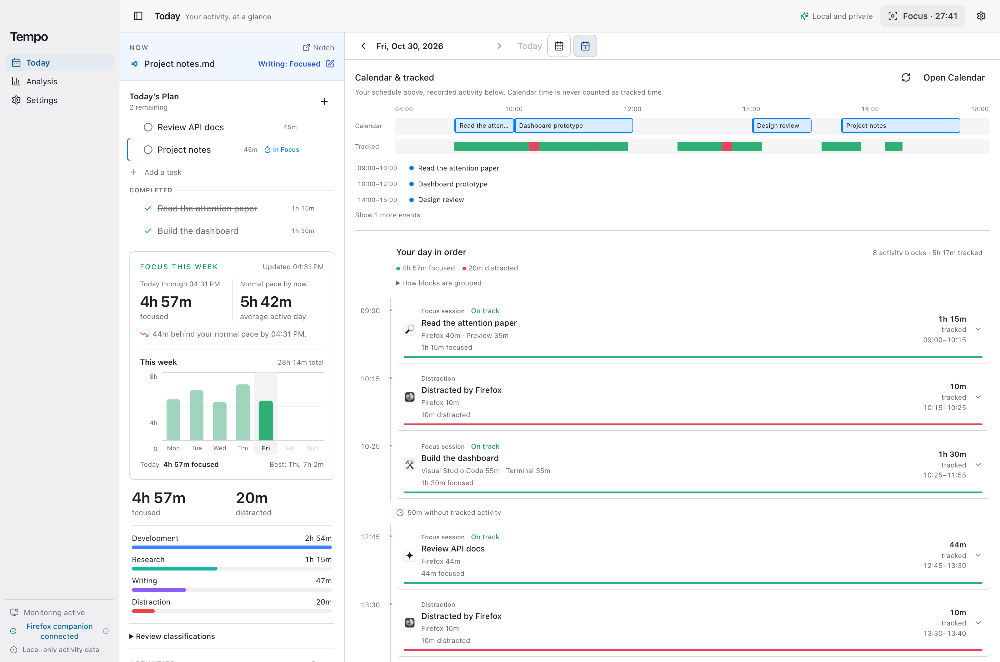
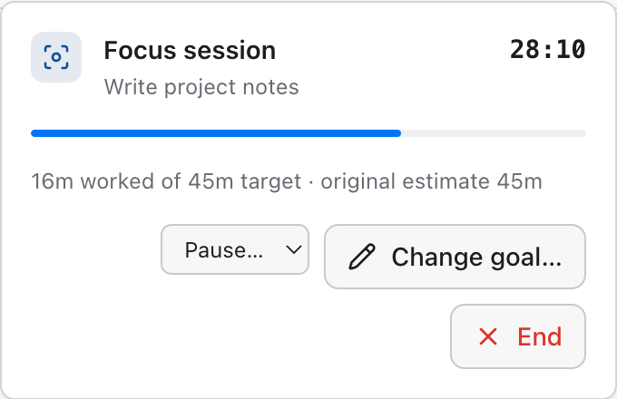
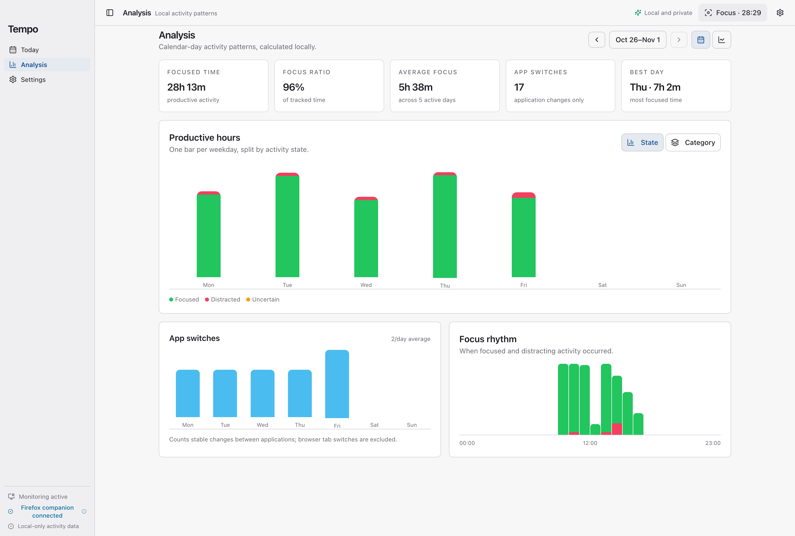

<div align="center">


# Tempo

A focus tracker for macOS, with local AI and a timer in your notch.

[](docs/BUILDING.md)
[](docs/BUILDING.md)
[](docs/LOCAL_AI.md)
[](LICENSE)

[Features](#features) · [Setup](#setup) · [Documentation](#documentation)

</div>



Tempo tracks the apps and pages you spend time on and compares them with what you're trying to get done. Reading documentation and scrolling through a feed can happen in the same browser, so it uses your current task to tell the difference. If it gets something wrong, you can correct it in the timeline.

## Features

| Feature               | What it does                                                                                                                       |
| --------------------- | ---------------------------------------------------------------------------------------------------------------------------------- |
| **Activity tracking** | See your day as a timeline, with time spent in each app and category.                                                              |
| **Local AI**          | Classify activity against your goals using Ollama. Choose Flexible, Balanced, or Strict, and correct mistakes to help Tempo learn. |
| **Focus & Pomodoro**  | Start a session from a task, set a time estimate, and take breaks. Sessions survive pauses, sleep, and restarts.                   |
| **Notch timer**       | Check your progress and control a session from the notch without switching windows.                                                |
| **Tasks & Reminders** | Plan tasks in Tempo or connect Apple Reminders. Tempo reads your reminders without changing them.                                  |
| **Browser support**   | Capture context from Firefox with the companion extension, or from Chrome and Safari. Firefox also has an optional OCR fallback.   |

## Focus sessions

Pick a task, choose how long to work, and start a Focus or Pomodoro session. Tempo uses that task as the goal when classifying your activity.

<p align="center">
  
</p>

## Where the time went

Review your day, compare weeks, or look at monthly totals. See which apps took up your time and when you got the most focused work done.



## Your data stays on your Mac

Tempo runs its AI through Ollama and keeps your activity history in a local MongoDB database. You don't need an account, and your activity isn't sent to a cloud AI service. Tempo doesn't collect telemetry.

Page text and OCR images are used for classification and then discarded. Your history includes app names, window titles, generated summaries, goals, and corrections. Older records may contain additional data; the [privacy notes](docs/NETWORK_NOTES.md) explain what's stored.

Apple Reminders access is optional. Accessibility can improve activity capture, and Screen Recording is only needed for the Firefox OCR fallback.

## Setup

You'll need an **Apple Silicon Mac running macOS 14 or later**. Tempo builds from source and needs the following installed:

| Install        | Requirements                                                               |
| -------------- | -------------------------------------------------------------------------- |
| Build tools    | Xcode Command Line Tools, Node **22.23.2**, Bun **1.4.0**, Python **3.11** |
| Local services | MongoDB Community **8.0**, Ollama with **`qwen3:4b-instruct`**             |

Start MongoDB and Ollama, then run:

```sh
git clone https://github.com/s-rode/Tempo.git
cd Tempo
bun run setup
bun run dev
```

The development app uses a separate profile and test database. To check the source and build an app bundle:

```sh
bun run typecheck
bun run test
bun run build
```

The [build guide](docs/BUILDING.md) covers Python setup, installation, backups, and native checks. Builds are signed locally; they aren't notarized.

<details>
<summary><strong>Setting up Firefox</strong></summary>

The build creates an unsigned ZIP of the [Firefox companion](electron-app/firefox-extension). Load it through Firefox's `about:debugging` page for development. You'll need to reload it after restarting Firefox. Permanent installation in standard Firefox requires a Mozilla-signed XPI.

</details>

## Built with

Electron, React, and TypeScript for the app; Swift/AppKit and Objective-C++ for the macOS integrations. A local Bun/tRPC server connects MongoDB storage with Ollama classification.

See the [architecture](docs/ARCHITECTURE.md) and [classification docs](docs/CLASSIFICATION.md) for more detail.

## Documentation

- [Build and install](docs/BUILDING.md)
- [Local AI and browser support](docs/LOCAL_AI.md)
- [Apple Reminders](docs/apple-reminders.md)
- [Privacy and stored data](docs/NETWORK_NOTES.md)
- [Classification evaluation](docs/CLASSIFICATION_VALIDATION.md)
- [Demo setup](docs/DEMONSTRATION.md)

## Credits & license

Tempo is developed by **s-rode** and builds on [Cronus](docs/PROVENANCE.md) by Moritz Wallawitsch and Arne Strickmann. It adds local AI, correction learning, task-based focus sessions, notch controls, Firefox support, Apple Reminders, and updated analytics.

Both Tempo and the Cronus foundation are licensed under [MIT](LICENSE). Original copyright notices are preserved in [NOTICE](NOTICE); dependencies and assets are covered in the [third-party notices](docs/THIRD_PARTY_NOTICES.md).
